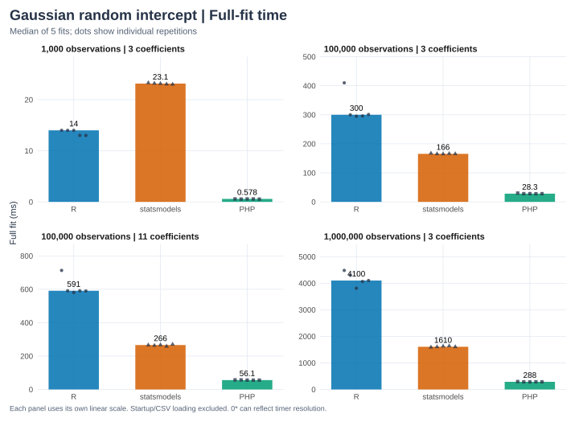
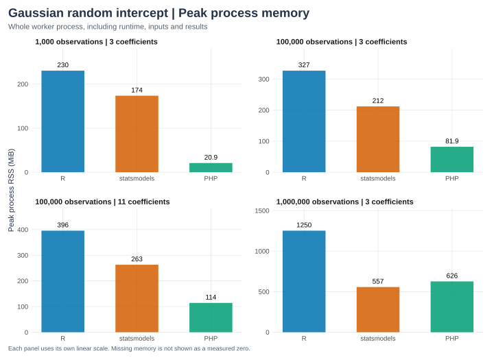

phit's `fit_mixed_gaussian_intercept_matrix()`, R lme4 `lmer()`, and Python statsmodels `MixedLM` fit identical simulated observations with one random intercept, by marginal ML (not REML), with plug-in GLS fixed-effect inference. The [raw report](lmm-results.json) records versions, machine and thread settings, artifact and data hashes, and every measurement.

## Methods

| Item | Setting |
| --- | --- |
| Workloads | 1,000, 100,000, and 1,000,000 rows with 3 fixed coefficients; 100,000 rows with 11 (counts include the intercept); min(100, n/20) groups |
| Data | Simulated with NumPy seed `20261011` (see [Simulation and numerical checks](#simulation-and-numerical-checks)) |
| Machine | AMD Ryzen 9 9955HX virtual machine, 2 cores, 7.8 GiB, Ubuntu 24.04.5 LTS (x86_64) |
| Builds | phit release build; runtime versions are printed below |
| Threads | Common BLAS and OpenMP thread variables set to 1 |
| Repetitions | One untimed warm-up, then five timed fits per worker; workers run separately and alternate order |
| Statistic | Median and minimum in-process wall-clock time |
| Timed | One complete fit with every output materialized (see [Timing boundaries and methods](#timing-boundaries-and-methods)) |
| Excluded | Startup, CSV parsing, data generation, and JSON serialization |
| Memory | Peak RSS of the whole worker process, from `peakmem` ([bench/peakmem.c](https://github.com/phpstats/phit/blob/main/bench/peakmem.c)) |

## Recorded results

```{python}
from pathlib import Path
import json,sys
import pandas as pd
ROOT=next(p for p in [Path.cwd(),*Path.cwd().parents] if (p/'Cargo.toml').exists())
report=json.loads((ROOT/'docs/benchmarks/lmm-results.json').read_text())
assert report['model']=='lmm'
print('Recorded:',report['recorded_at'],'Machine:',report['cpu'],report['platform'])
print('Repeats:',report['repeats'],'Warm-ups:',report['warmups'])
print('Tolerance policy:',report['tolerance'])
def ordered_table(rows):
    table=pd.DataFrame(rows)
    table['implementation']=pd.Categorical(table['implementation'],categories=['R','statsmodels','PHP'],ordered=True)
    return table.sort_values(['observations','coefficients','implementation']).reset_index(drop=True)
rows=[];memory=[]
for case in report['cases']:
    assert case['agreement_passed']
    for name,fit in case['implementations'].items():
        rows.append(dict(observations=case['n'],coefficients=case['p'],groups=case['data']['n_groups'],implementation=name,version=fit['version'],median_fit_ms=1000*fit['median_fit_seconds'],minimum_fit_ms=1000*fit['min_fit_seconds']))
        memory.append(dict(observations=case['n'],coefficients=case['p'],implementation=name,CSV_load_seconds=fit['load_seconds'],whole_process_seconds=fit['process_seconds'],peak_RSS_MiB=fit['peak_rss_bytes']/2**20 if fit['peak_rss_bytes'] else None))
display(ordered_table(rows))
```

Group count and group size affect mixed-model work, so these timings do not carry over to many thousands of small groups or to random slopes.

## Visual comparison

```{python}
#| echo: false
sys.path.insert(0,str(ROOT/'docs/benchmarks'))
from plots import render_charts
render_charts(report,'lmm')
```





Each panel uses its own labeled linear scale. Download timing [SVG](figures/lmm-fit-time.svg)/[PNG](figures/lmm-fit-time.png)
and memory [SVG](figures/lmm-memory.svg)/[PNG](figures/lmm-memory.png).

## Algorithm {#native-rust-optimization}

phit follows lme4's penalized least-squares elimination. It separates within-group deviations from group means and caches an augmented QR square-root summary, so each trial variance ratio factors p + 1 + G rows rather than all n. Covariance is computed only for the selected solution. The [walkthrough](../notebooks/lmm-math.qmd#cache-a-square-root-reduction-following-the-lme4-idea) derives the reduction and checks its residual norms numerically.

phit uses nalgebra QR and SVD with no BLAS, LAPACK, or sparse backend. lme4 uses a general sparse Cholesky factorization; phit's specialized reduction applies the same elimination and keeps SVD rank checks.

## Timing boundaries and methods

Timed calls include estimation, fixed-effect covariance and normal Wald inference, variance components,
ICC, likelihood/AIC, all population/conditional fits and both residual vectors,
and all conditional group estimates. PHP also validates/copies inputs and converts
all output arrays and group and sample metadata inside the timer.

R uses lmer REML=FALSE with bobyqa rhoend=1e-10. Python uses MixedLM ML BFGS with
gtol=1e-10 and recalculates plug-in GLS covariance to align with the documented
convention. Its own joint observed-Hessian covariance is a different convention and is not compared. Rust scans a log-ratio profile grid and refines analytic-score
roots with compact weighted SVD GLS fits, after a one-time QR reduction. The algorithms and stopping rules differ, so this compares complete API calls, not one common solver.

```{python}
display(ordered_table(memory))
```

Whole-process time includes startup/imports, CSV loading, warm-up and all five
fits. Peak RSS covers that entire process, not only the numerical solver. PHP's
memory limit is disabled for these large nested arrays. Timer resolution, system activity, and caches can affect results; see the [OLS timing discussion](ols.qmd#timing-boundaries).

## Simulation and numerical checks

NumPy RNG seed 20261011 generates correlated study hours and prior scores,
independent standard-normal extra predictors, and schools with roughly equal
sizes. Outcomes follow

$$y_i=50+1.8\,\mathrm{hours}_i+0.2\,\mathrm{prior}_i
+0.5\sum_j\mathrm{extra}_{ij}+b_{g(i)}+\epsilon_i,
\quad b_g\sim N(0,6^2),\quad\epsilon_i\sim N(0,5^2).$$

This sample is separate from the saved small teaching dataset. Identical
17-significant-digit CSVs are used by every worker. All coefficient-level fields,
variance components, ICC, likelihood/AIC and all group effects are checked.
Observation-length outputs are fully materialized, but cross-runtime checks sample
ten evenly spaced rows; small fixtures check every row.

Benchmark absolute tolerance is 1e-7. Relative tolerance is 1e-6 for ordinary
outputs, 1e-5 for covariance, SE, z-statistics, variance components, sigma, ICC, and random effects,
and 1e-9 for likelihood/AIC. Small saved references use the tighter uniform
1e-7 + 1e-6 × abs(reference) policy.
These tolerances apply to phit against R. statsmodels is checked against R as a peer, at 1e-6 + 1e-5 × abs(reference).
At a million rows the profiled likelihood cannot separate variance ratios that differ by about 1e-6 relative: lme4's
deviance at R's and at phit's solutions differs by 7e-8 on 6.06 × 10^6. Independent optimizers stop at different points
in that range, and the shrunken random effects move with the ratio, so they share the variance-sensitive tolerance.

At 100,000 rows, R's between-group variance differed from the analytic-score solution by about 2.6e-6 relative while log-likelihood differed
by only about 8e-10. The log-ratio profile score was approximately 2.55e-4 in R,
-1.88e-6 in Python and 3.12e-11 in Rust. A flat likelihood and the floating-point resolution of the objective limit how closely independently optimized variance components agree, and the variance-sensitive tolerances above reflect that measurement. Likelihood agreement keeps its tight tolerance. The finite profile grid is not a proof of global optimality.

```{python}
display(ordered_table([dict(observations=case['n'],coefficients=case['p'],implementation=name,
                           largest_absolute_difference_vs_R=max(errors.values()))
                      for case in report['cases'] for name,errors in case['max_absolute_errors_vs_R'].items()]))
```

## Reproduction

```sh
cargo build -p phit --release --locked
.context/notebooks-venv/bin/python tests/benchmarks/run.py --model lmm
QUARTO_PYTHON="$PWD/.context/notebooks-venv/bin/python" \
  quarto render docs/benchmarks/lmm.qmd
```

R needs lme4. Set matching `PHP` and `PHP_CONFIG`, and use `.so` on Linux. For a quick check that leaves the published report unchanged, add `--cases 1000:3 --repeats 2 --output .context/lmm-smoke.json`. A numerical failure aborts the run without writing results. See the [contract](../reference-models.qmd#gaussian-random-intercept-mixed-model)
for model and inference limits.
