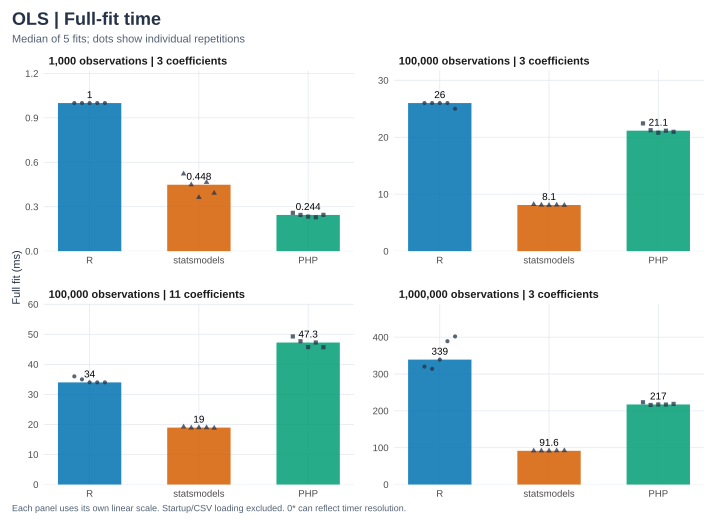
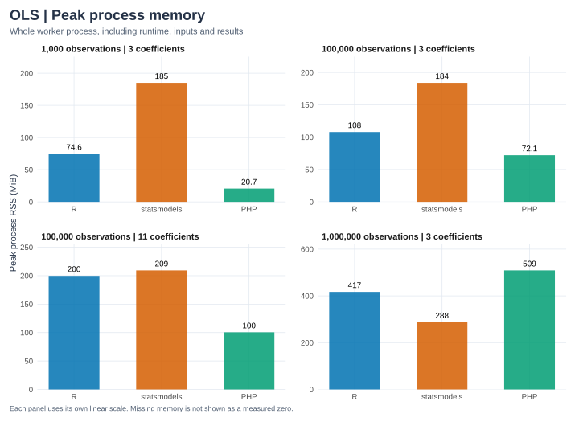

phit's `fit_ols_matrix()`, R `lm()`, and Python statsmodels `OLS` fit identical simulated observations at four sizes. The [results JSON](ols-results.json) records every timing sample, versions, input hashes, numerical outputs, agreement errors, and machine details.

## Methods

| Item | Setting |
| --- | --- |
| Workloads | 1,000, 100,000, and 1,000,000 rows with 3 coefficients; 100,000 rows with 11 coefficients (coefficient counts include the intercept) |
| Data | Simulated rents, generated with NumPy seed `20261011`; all runtimes read the same 17-significant-digit CSV |
| Machine | Apple M5 Ultra, macOS 27, recorded 2026-10-16 |
| Builds | phit release build; versions of R, statsmodels, NumPy, PHP, and Rust are printed below |
| Threads | Common BLAS and OpenMP thread variables set to 1. phit has no BLAS backend |
| Repetitions | One untimed warm-up, then five timed fits per worker; workers run separately and alternate order between cases |
| Statistic | Median and minimum in-process wall-clock time |
| Timed | One complete fit with all outputs materialized (see [Timing boundaries](#timing-boundaries)) |
| Excluded | Data generation, CSV parsing, process startup, and JSON serialization |
| Memory | Peak RSS of the whole worker process, from `/usr/bin/time` |

## Recorded results

```{python}
from pathlib import Path
import json
import pandas as pd

# Keep display order independent of the benchmark worker execution order.
def ordered_table(rows):
    table = pd.DataFrame(rows)
    table["implementation"] = pd.Categorical(
        table["implementation"], categories=["R", "statsmodels", "PHP"], ordered=True)
    return table.sort_values(["observations", "coefficients", "implementation"]).reset_index(drop=True)

ROOT = next(p for p in [Path.cwd(), *Path.cwd().parents] if (p / "Cargo.toml").exists())
report = json.loads((ROOT / "docs/benchmarks/ols-results.json").read_text())
print("Recorded:", report["recorded_at"])
print("Machine:", report["cpu"], "—", report["platform"])
print("Rust:", report["rust"])
print("Measured repetitions:", report["repeats"], "after", report["warmups"], "warm-up fit")
timings, memory = [], []
for case in report["cases"]:
    assert case["agreement_passed"]
    for name, result in case["implementations"].items():
        timings.append({"observations": case["n"], "coefficients": case["p"],
                        "implementation": name, "version": result["version"],
                        "median fit (seconds)": result["median_fit_seconds"],
                        "minimum fit (seconds)": result["min_fit_seconds"]})
        memory.append({"observations": case["n"], "coefficients": case["p"],
                       "implementation": name, "CSV load (seconds)": result["load_seconds"],
                       "whole process (seconds)": result["process_seconds"],
                       "peak process RSS (MiB)": (result["peak_rss_bytes"] / 2**20
                                                  if result["peak_rss_bytes"] else None)})
display(ordered_table(timings))
```

R's elapsed timer has millisecond resolution on the recorded Mac, so the 1,000-row fits can read as zero. Use the larger cases to assess scale. A tall model with few predictors and a wider model are different workloads.

## Visual comparison

```{python}
#| echo: false
import sys
sys.path.insert(0, str(ROOT / "docs/benchmarks"))
from plots import render_charts
render_charts(report, "ols")
```





Each panel has its own linear scale, so compare labeled values across panels. Download the timing [SVG](figures/ols-fit-time.svg) or [PNG](figures/ols-fit-time.png) and memory [SVG](figures/ols-memory.svg) or [PNG](figures/ols-memory.png). Rendering redraws the charts from the saved measurements without rerunning the benchmark.

## Timing boundaries

Inputs are already PHP arrays, an R data frame, or NumPy arrays when the timer starts. Each timed fit materializes coefficients, covariance, standard errors, Student t tests, p-values, 95% confidence intervals, all fitted values and residuals, RSS, variance, R-squared, and the Gaussian log-likelihood. Cleanup between fits is outside the timer.

| Implementation | Timed work | Solver |
| --- | --- | --- |
| phit | Validation, copying PHP inputs into Rust, estimation, and converting the full result into PHP arrays with row metadata | Column-scaled SVD |
| R | `lm()`, including model and formula construction, and inference | QR |
| statsmodels | `OLS(...).fit(use_t=True)`, forcing lazy inference and full observation-length outputs | Pseudoinverse (SVD) |

These are API-level comparisons, not matrix-kernel or language-speed measurements. The thread settings control common threading differences but do not prove every backend honors them. System activity, caches, and thermal state can affect the timings, and five warm fits on one machine do not establish a general ranking.

## Memory and whole-process time

```{python}
display(ordered_table(memory))
```

Whole-process time covers startup and imports, loading, the warm-up, all timed fits, cleanup, and report serialization. It is not a single cold-fit time. Peak RSS covers the whole worker process, including the runtime, inputs, temporary arrays, and results. PHP's memory limit is disabled for these runs, because a million nested arrays can exceed a web application's limit.

## Simulation and numerical agreement

Area is uniform between 35 and 110 square meters. Bedrooms depend on area plus noise, rounded and bounded to 1–4. Wider models add independent standard-normal amenity scores. Rent follows

$$y_i=650+18\,\mathrm{area}_i+60\,\mathrm{bedrooms}_i
+0.5\sum_j\mathrm{amenity}_{ij}+\epsilon_i,
\qquad\epsilon_i\sim N(0,180^2).$$

The large samples are fresh draws, not copies of the eight teaching rows, and their generating model includes a bedroom effect. The CSV hash, population coefficients, and sample correlations are recorded.

The harness checks every coefficient, covariance entry, standard error, t statistic, p-value, confidence bound, and scalar statistic against R at `1e-9 + 1e-7 * abs(reference)`, and residual df exactly. Fitted values and residuals are computed in full but compared at ten evenly spaced observations; the small reference tests compare full vectors. The absolute tolerance does not establish relative accuracy for very small p-values.

```{python}
agreement = []
for case in report["cases"]:
    for name, errors in case["max_absolute_errors_vs_R"].items():
        agreement.append({"observations": case["n"], "coefficients": case["p"],
                          "implementation": name, "agreement passed": case["agreement_passed"],
                          "largest absolute difference vs R": max(errors.values())})
display(ordered_table(agreement))
```

The first large-sample run exposed inaccurate 95% Student-t quantiles from statrs' inverse-beta calculation. phit now finds the critical value by bisecting the Student-t survival function at probability 0.025, and a Rust test checks R `qt()` references up to 999,997 residual df with absolute error below 1e-8.

## Reproduction

Use the [development setup](../development.qmd) and the pinned [notebook dependencies](../notebooks/index.qmd). From the repository root on macOS:

```sh
cargo build -p phit --release --locked
.context/notebooks-venv/bin/python tests/benchmarks/run.py
QUARTO_PYTHON="$PWD/.context/notebooks-venv/bin/python" \
  quarto render docs/benchmarks/ols.qmd
```

- On Linux, set matching `PHP` and `PHP_CONFIG`. The driver defaults to the release `.so`. Override `STATS_EXTENSION` or `RSCRIPT` when needed.
- `--cases` takes comma-separated `n:p` pairs, with the intercept included in p and n > p ≥ 3. `--repeats` sets the number of timed fits.
- The driver writes a report only after every case passes. Worker errors and numerical discrepancies fail the run, and workers time out after ten minutes.

A quick harness check that leaves the published report unchanged:

```sh
.context/notebooks-venv/bin/python tests/benchmarks/run.py \
  --cases 1000:3 --repeats 2 --output .context/benchmark-smoke.json
```
