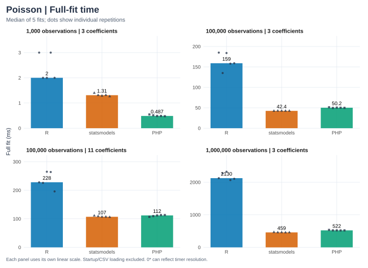
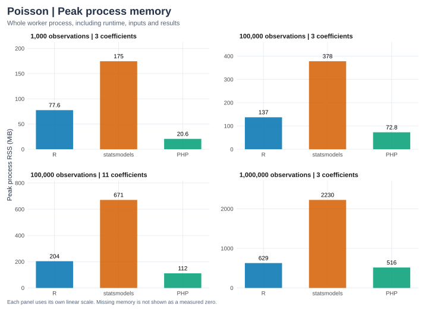

phit's `fit_poisson_matrix()`, R `glm(poisson)`, and statsmodels `GLM` with the Poisson family fit identical simulated observations at four sizes. The [raw report](poisson-results.json) keeps every timing sample, machine and runtime versions, input hashes, numerical outputs, and differences from R.

## Methods

| Item | Setting |
| --- | --- |
| Workloads | 1,000, 100,000, and 1,000,000 rows with 3 coefficients; 100,000 rows with 11 coefficients (counts include the intercept) |
| Data | Simulated with NumPy seed `20261011` (see [Simulation and agreement](#simulation-and-agreement)); all runtimes read the same 17-significant-digit CSV |
| Machine | AMD Ryzen 9 9955HX virtual machine, 2 cores, 7.8 GiB, Ubuntu 24.04.5 LTS (x86_64) |
| Builds | phit release build; runtime versions are printed below |
| Threads | Common BLAS and OpenMP thread variables set to 1 |
| Repetitions | One untimed warm-up, then five timed fits per worker; workers run separately and alternate order between cases |
| Statistic | Median and minimum in-process wall-clock time |
| Timed | One complete fit with every output materialized, including PHP input and output conversion |
| Excluded | Startup, CSV loading, data generation, and JSON serialization |
| Memory | Peak RSS of the whole worker process, from `peakmem` ([bench/peakmem.c](https://github.com/phpstats/phit/blob/main/bench/peakmem.c)) |

The harness is shared with the [OLS benchmark](ols.qmd#timing-boundaries), which describes the boundaries in more detail.

## Recorded results

```{python}
from pathlib import Path
import json
import pandas as pd

# Keep display order independent of the benchmark worker execution order.
def ordered_table(rows):
    table = pd.DataFrame(rows)
    table["implementation"] = pd.Categorical(
        table["implementation"], categories=["R", "statsmodels", "PHP"], ordered=True)
    return table.sort_values(["observations", "coefficients", "implementation"]).reset_index(drop=True)

ROOT = next(p for p in [Path.cwd(), *Path.cwd().parents] if (p / "Cargo.toml").exists())
report = json.loads((ROOT / "docs/benchmarks/poisson-results.json").read_text())
assert report["model"] == "poisson"
print("Recorded:", report["recorded_at"])
print("Machine:", report["cpu"], report["platform"])
print("Rust:", report["rust"])
print("Repeats:", report["repeats"], "Warm-ups:", report["warmups"])
rows, memory = [], []
for case in report["cases"]:
    assert case["agreement_passed"]
    for name, fit in case["implementations"].items():
        rows.append({"observations": case["n"], "coefficients": case["p"],
                     "implementation": name, "version": fit["version"],
                     "median full fit (ms)": 1000*fit["median_fit_seconds"],
                     "minimum full fit (ms)": 1000*fit["min_fit_seconds"]})
        memory.append({"observations": case["n"], "coefficients": case["p"],
                       "implementation": name, "CSV load (s)": fit["load_seconds"],
                       "whole process (s)": fit["process_seconds"],
                       "peak process RSS (MiB)": fit["peak_rss_bytes"]/2**20 if fit["peak_rss_bytes"] else None})
display(ordered_table(rows))
```

R's elapsed timer has millisecond resolution, so the smallest fits are coarse. These measurements describe this workload on this machine.

## Visual comparison

```{python}
#| echo: false
import sys
sys.path.insert(0, str(ROOT / "docs/benchmarks"))
from plots import render_charts
render_charts(report, "poisson")
```





Each panel has its own linear scale, so compare labeled values across panels. Download the timing [SVG](figures/poisson-fit-time.svg) or [PNG](figures/poisson-fit-time.png) and memory [SVG](figures/poisson-memory.svg) or [PNG](figures/poisson-memory.png).

## Timing boundaries

Each timed fit materializes coefficients, covariance, standard errors, normal z tests, p-values, Wald intervals, every fitted mean count and response residual, likelihood, deviance, null deviance, AIC, and residual df.

| Implementation | Fitting |
| --- | --- |
| phit | Weighted SVD Newton updates, with phit's convergence rules |
| R | Formula and model construction, then QR-based IRLS with epsilon 1e-16 |
| statsmodels | IRLS with parameter tolerance 1e-11 |

Starting values, linear solves, and stopping criteria differ, so iteration counts differ too. This compares complete public API calls, not decomposition speed.

```{python}
display(ordered_table(memory))
```

Whole-process time includes loading, imports, the warm-up, and every timed fit. Peak RSS covers the whole worker, not only the solver. PHP's `memory_limit` is disabled, because large nested PHP arrays can exceed typical application limits.

## Simulation and agreement

After the common benchmark setup, visitor counts are integers uniform from 80 to 300, and staffing is visitors/50 plus normal noise with standard deviation 0.8, clipped. The wider case adds independent standard-normal scores. Outcomes are draws from

$$\mu_i=\exp(0.1+0.005\,\mathrm{visitors}_i-0.12\,\mathrm{staff}_i
+0.1\sum_j\mathrm{extra}_{ij}),\qquad y_i\sim\operatorname{Poisson}(\mu_i).$$

This simulation is separate from the small teaching sample. Data hashes, generating coefficients, and sample correlations are recorded.

Coefficient-level quantities and scalar statistics are compared with R at `1e-9 + 1e-7 * abs(reference)`. Fitted values and residuals are computed in full and compared at ten evenly spaced rows; the small fixtures compare full vectors. phit must report convergence within 1 to 100 updates. Wald intervals follow R `confint.default()`, and the null baseline follows the documented intercept convention. Poisson deviance uses the saturated count likelihood, not −2 log-likelihood.

```{python}
display(ordered_table([{ "observations": case["n"], "coefficients": case["p"],
                        "implementation": name, "largest absolute difference vs R": max(errors.values())}
                       for case in report["cases"]
                       for name, errors in case["max_absolute_errors_vs_R"].items()]))
```

## Reproduction

```sh
cargo build -p phit --release --locked
.context/notebooks-venv/bin/python tests/benchmarks/run.py --model poisson
QUARTO_PYTHON="$PWD/.context/notebooks-venv/bin/python" \
  quarto render docs/benchmarks/poisson.qmd
```

Set matching `PHP` and `PHP_CONFIG`, and use `.so` on Linux. For a quick check that leaves the published report unchanged, add `--cases 1000:3 --repeats 2 --output .context/poisson-smoke.json`. A numerical failure aborts the run without writing results.
